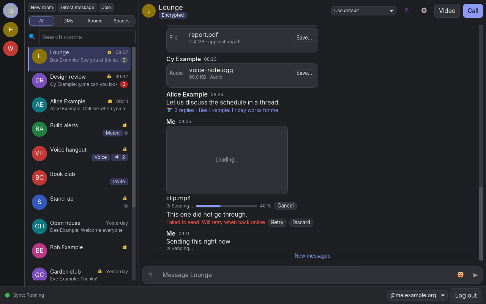
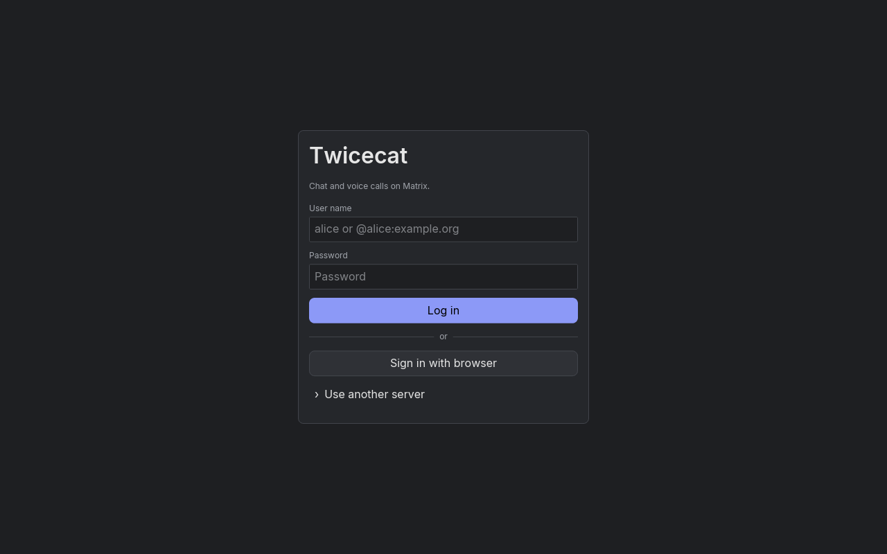
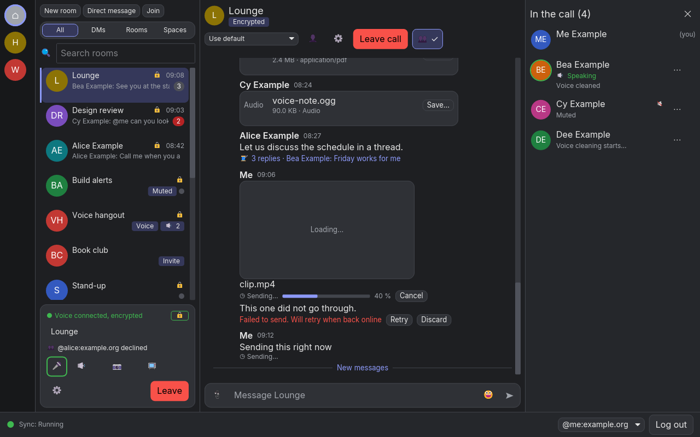
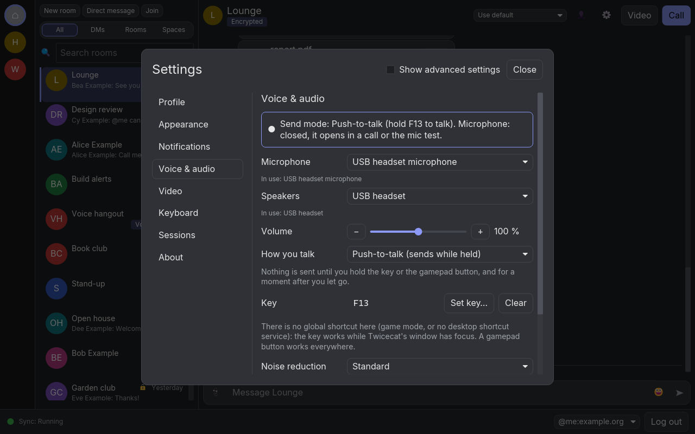

# Twicecat

[](https://github.com/ga-lep/twicecat/actions/workflows/ci.yml)

A native desktop [Matrix](https://matrix.org) client, written in Rust with [iced](https://iced.rs). It talks to the same rooms, encryption and calls as Element, without a webview. It runs on Linux (Wayland and X11), Windows and macOS:

- **Chat:** rooms and direct messages, replies, edits, reactions, mentions and markdown, files and images, notifications.
- **End-to-end encryption:** device verification, cross-signing, key backup and recovery, sessions.
- **Calls:** voice and video calls (MatrixRTC on a LiveKit SFU, compatible with Element Call), screen sharing, push-to-talk with a global key or a gamepad button, and noise suppression on the CPU or the GPU.



| Logging in | A call | Voice & audio settings |
| --- | --- | --- |
|  |  |  |

The screenshots come from the headless UI gallery (below), drawn by tiny-skia, not by the window's wgpu renderer.

## Status

Twicecat is in early development. The first pre-release, [v0.1.0-alpha](https://github.com/ga-lep/twicecat/releases/tag/v0.1.0-alpha), has packages for Linux on x86_64 and aarch64 (AppImage, `.deb`, `.rpm`, Flatpak, `.tar.zst`), Windows (MSI) and macOS on Apple Silicon (DMG). They are not signed yet. It is built in phases. Each phase has a plan in [`docs/plans/`](docs/plans/), and [`PROGRESS.md`](PROGRESS.md) records what was done, what was checked and what is left.

| Phase | What | Where it stands |
| --- | --- | --- |
| 0–2 | Workspace and CI; the headless core and `twicecat-cli`; the iced shell | Done |
| 3–4 | Timeline and composer; end-to-end encryption | Done |
| 5 | Media and notifications | Done; some human checks open |
| 6 | Calls, call UI, push-to-talk | Merged; experimental |
| 9 | Video: cameras and screen sharing | Merged; experimental |
| — | UI/UX rework: new screens, colour sets, accessibility | Merged |
| 7 | Packages and releases | In progress: the first pre-release is out; install notes and package repositories are next |

Still experimental: calls, video, and voice cleaning on the GPU. Rendering, audio devices, hotkeys on Wayland, OS dialogs and real accounts cannot be checked by tests; they are human checkpoints in `PROGRESS.md`, and some of them are still open.

## Workspace

| Path | What |
| --- | --- |
| `crates/core` | The headless Matrix client and calls (matrix-sdk, LiveKit), and the `twicecat-cli` binary |
| `crates/app` | The iced desktop app, `twicecat`. It talks to the core only through the core's commands and events, and never depends on matrix-sdk directly; `scripts/check-app-deps.sh` enforces this |
| `crates/audio` | Audio devices and the voice engine: mixing, echo cancelling, noise suppression (WebRTC, RNNoise, DeepFilterNet3), gain and gate |
| `crates/video` | Video frames, colour conversion on the CPU or the GPU, screen capture and the quality ladder |
| `crates/ptt` | Push-to-talk: global keys and gamepad buttons |
| `crates/perf` | Recording performance indicators in tests |
| `packaging/` | Icons, the desktop entry, AppStream data, the Flatpak and the package configs |
| `dev/` | Configuration for the local stack and the build images |
| `scripts/` | Fetching pinned downloads, the local stack, checks, packaging |

## Building

You need Rust 1.97.1 (pinned in `rust-toolchain.toml`, rustup installs it), and on Linux clang 21 or newer (`CC=clang-22 CXX=clang++-22`; Ubuntu 24.04's clang 18 is too old), `lld` and the glib, Wayland, X11 and audio development packages. libwebrtc comes only from a script that checks its pinned hash; run it once before the first build:

```bash
scripts/fetch-libwebrtc.sh
```

On Windows, export the path it prints as `LK_CUSTOM_WEBRTC`. [`docs/building.md`](docs/building.md) has the full list per OS, the light and full (GPU) builds, the models and runtimes the GPU build loads, and packaging.

## Running

```bash
cargo run --release -p twicecat-app
```

`--release` matters for calls: the audio chain is much slower in a debug build. The app takes:

- `--homeserver <url>`: use this homeserver instead of discovering it from the user ID;
- `--ephemeral`: keep secrets in memory and use a temporary data directory, deleted on exit;
- `--data-dir <path>`: keep the session somewhere other than the OS data directory.

`twicecat-cli` is a text client on the same core, for scripts and tests. It takes the same flags, and more (`--help`):

```bash
cargo run -p twicecat-core --bin twicecat-cli -- --help
```

The app and the CLI share their data directory and keychain entry. Don't run both on the same data directory at once.

## Testing against a local homeserver

Tests and manual checks run against a local Synapse and LiveKit in Docker, with the throwaway accounts in `.env.test`. Never use a real account. To start the stack and register the test users (this needs Docker, `curl` and `jq`):

```bash
scripts/stack.sh up -d --wait
```

```bash
scripts/create-test-users.sh
```

Then point the app at it, for example `cargo run --release -p twicecat-app -- --ephemeral --homeserver http://127.0.0.1:8008`. `scripts/run-integration-tests.sh` runs the tests that need the stack, and `scripts/stack.sh down -v` removes it. [`docs/testing.md`](docs/testing.md) explains the test tiers and what runs where.

To regenerate the screenshots, run the UI gallery. It writes a PNG of every screen, in every colour set, mode and density, and an `index.html`, without a window:

```bash
TWICECAT_GALLERY_DIR=target/ui-gallery cargo test -p twicecat-app --test ui_gallery -- --ignored
```

## Contributing

Every commit passes this gate:

```bash
cargo fmt --all
```

```bash
cargo clippy --workspace --all-targets -- -D warnings
```

```bash
cargo test --workspace
```

```bash
cargo check --workspace --lib --bins --locked
```

CI also runs the `scripts/check-*.sh` checks (for example `check-app-deps.sh`, `check-core-api.sh` and `check-no-webrtc-download.sh`) and `cargo deny check`. Commits are [Conventional Commits](https://www.conventionalcommits.org) with a `Step:` trailer, one per step. [`AGENTS.md`](AGENTS.md) has the rules for maintainers and coding agents: pinned versions, the core and app boundary, and what needs a human check.

## Accessibility

[`docs/accessibility.md`](docs/accessibility.md) covers the keyboard map, colour sets and contrast, zoom, screen readers, and the known limits of iced.

## Licence

Twicecat is under the GNU General Public License, version 3 or later: see [`LICENSE`](LICENSE).

It bundles the Inter typeface under the SIL Open Font License 1.1; [`THIRD-PARTY-NOTICES.md`](THIRD-PARTY-NOTICES.md) has the details, and every installer must ship the notices. The DeepFilterNet3 models, ONNX Runtime, libwebrtc and NVIDIA's CUDA files are not in the repository: the `scripts/fetch-*.sh` scripts download them, each checked against a pinned SHA-256, under their own licences. The packages carry the generated notices for everything they bundle.

## Security

Please report a vulnerability privately, through **Report a vulnerability** on the repository's [Security tab](https://github.com/ga-lep/twicecat/security), not in a public issue. [`SECURITY.md`](SECURITY.md) has the details.

Twicecat must never log access tokens, keys or message bodies, at any log level, and tests check for it. A secret in a log is a vulnerability: report it the same way.
